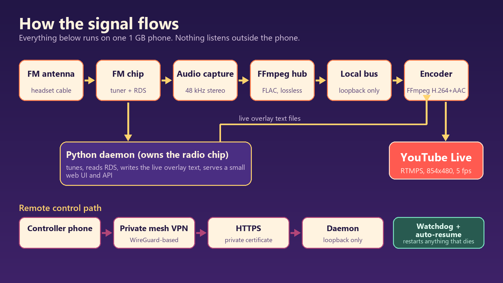

# Redmi Go FM station

Turn a rooted, 1 GB Android phone with a built-in FM tuner into a small always-on radio box: it tunes FM, decodes RDS
(station name and radio text), captures the audio digitally, and can push a live stream with a text overlay to YouTube.
Everything is controlled from a small web UI that is reachable only over a private mesh VPN.



## What it does
- **FM tuner daemon** (`daemon/fm_tuner.py`, `daemon/fmchip.py`): owns the radio device, tunes, reads RDS, serves a token-protected web UI and JSON API.
- **Audio hub** (`scripts/fm-stream.sh`): digital capture, lossless FLAC through ffmpeg into a loopback-only Icecast.
- **YouTube service** (`daemon/yt_service.py`): supervised ffmpeg (backdrop image + live RDS text, H.264 + AAC), exponential backoff, stall watchdog, resume after restart. The stream key is write-only.
- **Watchdog** (`scripts/fm-watchdog.sh`): wakelock, low-memory-killer protection, restarts dead services, recovers Wi-Fi, and keeps the battery between 70 and 80 % so the phone can sit on a charger permanently.
- **LAN listener** (`daemon/lan_listen.py`, `scripts/fm-lan.sh`): optional, off by default. A read-only proxy that serves only the audio to private-network clients, with a listener cap. See below.
- **Boot** (`magisk/99-fm-server.sh`): Magisk `service.d` script that starts everything after a reboot or power cut.
- **Remote access** (`scripts/fm-tailscale.sh`): Tailscale in userspace networking inside the chroot; `tailscale serve` publishes the UI to your tailnet only.

## Requirements
- A rooted Android phone with a working FM receiver and a headset or antenna cable. Developed on a Redmi Go (Snapdragon 425, Android 8.1). The FM chip control is device-specific and was reverse-engineered, so other phones will need changes in `daemon/fmchip.py`.
- A Debian armhf chroot at `/data/debian` with `python3`, `ffmpeg`, `icecast2` and `tailscale`.
- Scripts go to `/data/local/fm/`, the daemon to `/data/debian/opt/fm/`, and `magisk/99-fm-server.sh` to `/data/adb/service.d/`.

## Setup outline
1. Copy `config/fm.env.example` to `/root/fm.env` inside the chroot, set a long random `ICECAST_SOURCE_PASSWORD`, and `chmod 600` it. Configure Icecast with the same source password and loopback binding.
2. `fm-tailscale.sh login` (set `TS_HOSTNAME` first if you want a custom node name), then publish the UI with `tailscale serve` to `127.0.0.1:<FM_PORT>`.
3. `fm-tuner.sh start` generates an access token the first time; read it with `fm-tuner.sh token` and paste it into the web UI.
4. Paste your stream key in the Stream tab. It is stored in a root-only file and never shown again.

## Listening on your local network (optional)
```
fm-lan.sh enable     # sets FM_LAN_LISTEN=1, starts the listener, prints the URL
fm-lan.sh disable    # switches it off again
fm-lan.sh status
```
Then open `http://<phone-ip>:8081/` (a small player page) or `http://<phone-ip>:8081/fm.flac` (VLC, or most desktop browsers).
Icecast and the tuner API stay on loopback; the listener serves only `/` and `/fm.flac`, only to RFC 1918 / loopback / link-local clients,
and at most `FM_LAN_MAX` (default 5) at once. The stream is lossless FLAC, about 1 Mbit/s per listener: it needs a decent Wi-Fi link.
The watchdog keeps Wi-Fi power-save off because it adds hundreds of milliseconds of latency, and restarts the listener if it dies.

## Tests
`python -m unittest discover -s tests -v` (stdlib only; covers the LAN listener: proxying, path and method allow-list, listener cap, client filter).

## Security design
See [docs/security.md](docs/security.md). In short: by default nothing listens outside the phone, access is through a private mesh only,
every API call needs a token, the YouTube key is write-only, and untrusted over-the-air text is never interpreted by ffmpeg.

## Legal note
This project rebroadcasts whatever the tuner receives. Radio programmes and the music in them are protected by copyright and
related rights. Only stream content you own, content licensed for rebroadcast, or content you have explicit permission to
rebroadcast. This repository does not include, and will not accept, any feature that alters audio to avoid copyright detection.

## Status
Personal hobby project, provided as is. Not tested against many devices; expect to adapt the chip layer.

## License
MIT, see [LICENSE](LICENSE).
